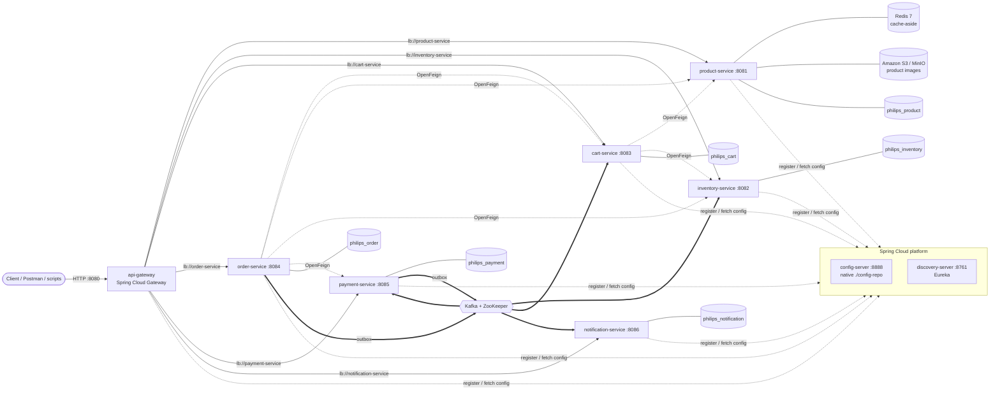
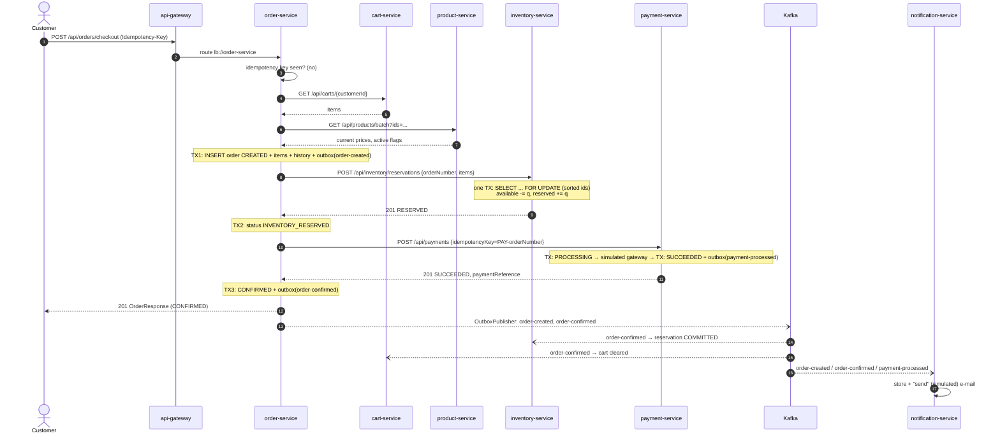
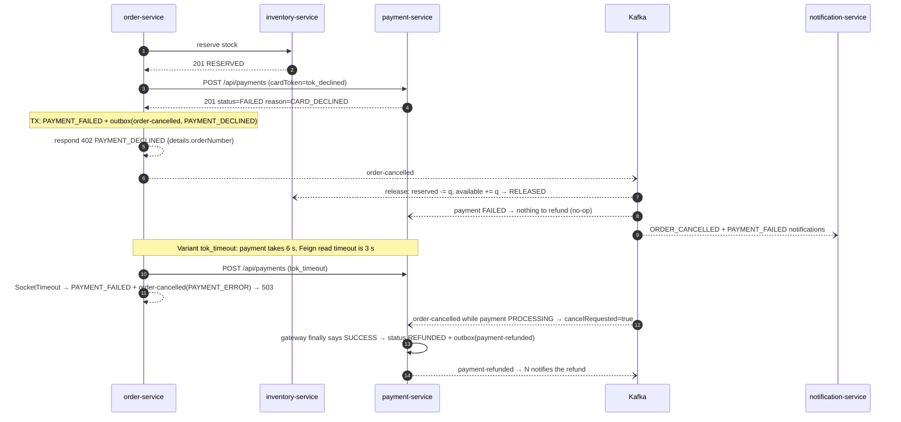
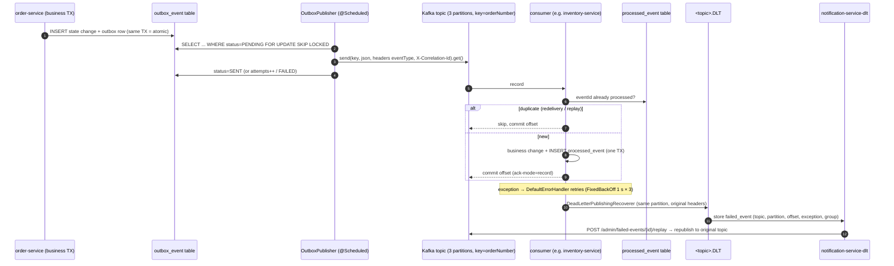
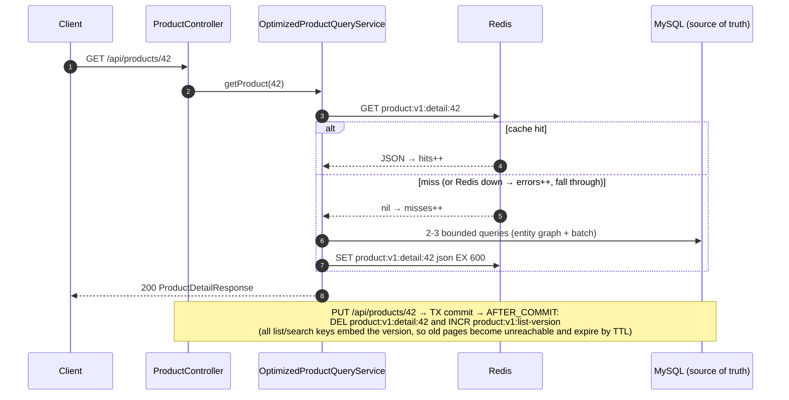
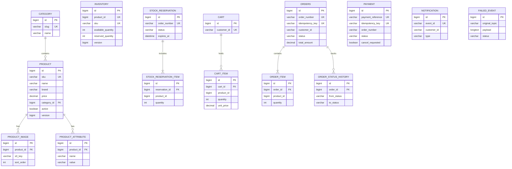

# Architecture

Diagrams are written in Mermaid. They render on GitHub and GitLab, in IntelliJ (Markdown plugin), and in VS Code
(the "Markdown Preview Mermaid Support" extension), or you can paste them into https://mermaid.live.
Pre-rendered SVGs of every diagram (generated with mermaid-cli 11) are in [`docs/diagrams/`](diagrams/).

## 1. Overall architecture

* **Synchronous** (OpenFeign + Eureka client-side load balancing + Resilience4j retry and circuit breaker): calls
  where the caller needs an answer to continue: validating the cart, pricing, reserving stock, charging payment.
* **Asynchronous** (Kafka): state changes that other services react to: commit or release stock, clear the cart,
  refund, notify. Producers use a **transactional outbox**, and consumers are **idempotent** (`processed_event` table).
* **Database per service**: six schemas on one MySQL server locally. No service reads another service's tables.

## 2. Checkout saga: happy path

## 3. Payment failure and compensation

Inventory failures follow the same pattern: a `409 INSUFFICIENT_STOCK` means nothing was reserved, so the order goes
straight to `CANCELLED`. A timeout means a reservation *may* exist, so the order is `CANCELLED` and `order-cancelled` is
still published, and inventory-service releases the reservation if it exists. The reservation-expiry job is the safety
net if every message were lost.

## 4. Kafka processing: outbox, idempotent consumer, retry, DLT, replay

## 5. Redis cache-aside (product-service, optimized mode)

## 6. Database relationships (one schema per service)

The order-service and payment-service schemas also have `outbox_event`. The inventory, cart and payment schemas have
`processed_event`. Cross-service references (for example `order_item.product_id`) are **logical** IDs, not foreign
keys, because each service owns its own database.

## 7. Consistency model

| Concern | Mechanism | Where |
|---|---|---|
| Atomic "update DB + publish event" | Transactional outbox | `order-service/.../outbox`, `payment-service/.../outbox` |
| At-least-once delivery → effectively once | `processed_event` / unique `event_id` checked in the business TX | inventory, cart, payment, notification consumers |
| Duplicate checkout | Unique `orders.idempotency_key`, replay returns stored order | `CheckoutService` |
| Duplicate payment | Unique `payment.idempotency_key` (`PAY-<orderNumber>`) | `PaymentService` |
| Overselling | `SELECT ... FOR UPDATE` in sorted product order, all-or-nothing | `ReservationService` |
| Lost compensation | Reservation TTL expiry job | inventory-service scheduler |
| Concurrent admin edits | `@Version` optimistic locking → 409 `CONCURRENT_MODIFICATION` | entities with `version` |
| Per-order ordering | Kafka key = orderNumber (same partition) | all producers |
